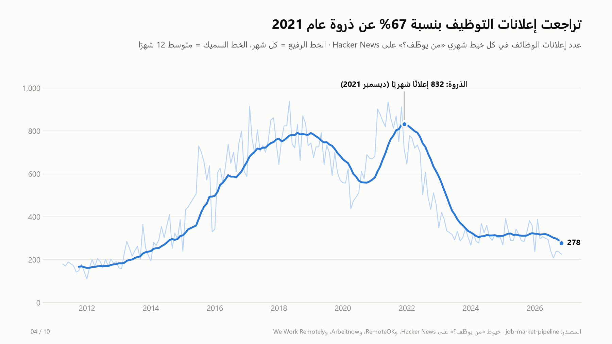
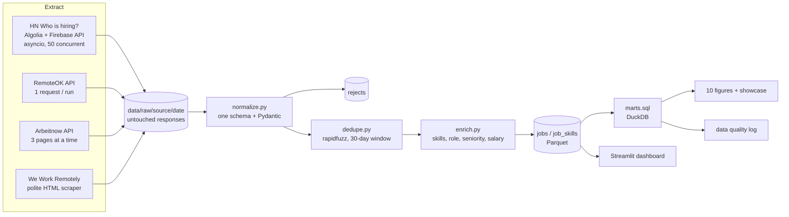

[English](README.md)

<div dir="rtl">

# job-market-pipeline

خمسة عشر عامًا من التوظيف التقني، جُمعت من أربع منصات توظيف، ونُظّفت في جدول واحد،
ثم حُوّلت إلى نتائج. **ابدأ بصفحة العرض: [reports/SHOWCASE.ar.md](reports/SHOWCASE.ar.md)**
(مقدمة، و10 رسوم بيانية، وجولة في لوحة المعلومات).

**لوحة المعلومات الحية: <https://tech-hiring-2011-2026.streamlit.app>** — يمكن التصفية حسب المصدر
والدور والمهارة والسنة. (مستضافة على Streamlit Community Cloud، وقد تستغرق بضع ثوانٍ حتى
تستيقظ إذا لم يزرها أحد مؤخرًا.) الواجهة متاحة بالعربية والإنجليزية: استخدم مفتاح اللغة في الشريط
الجانبي، أو افتح <https://tech-hiring-2011-2026.streamlit.app/?lang=ar> مباشرةً.

## النتائج باختصار

92,571 إعلان وظيفة نظيفًا من 102,126 طلبًا و273 ميغابايت من البيانات الخام، من أبريل 2011 إلى نوفمبر 2026.
الاتجاهات طويلة الأمد مأخوذة من خيوط «Who is hiring?» على Hacker News فقط.

| | النتيجة |
|---|---|
| حجم التوظيف | بلغ متوسط 12 شهرًا ذروته عند 832 إعلانًا شهريًا في ديسمبر 2021، وهو الآن 278، أي بانخفاض 67% |
| العمل عن بُعد | 13% من الإعلانات في 2011 ← 29% في 2019 ← 83% في 2022 ← 54% في 2026 |
| الذكاء الاصطناعي | ظلت إشارات الذكاء الاصطناعي وتعلّم الآلة مستقرة قرب 18% حتى 2022، ثم بلغت 60% في 2026؛ ومصطلحات النماذج اللغوية الكبيرة والوكلاء من 0% ← 25% |
| لغات البرمجة | Python من 17% ← 26%، وTypeScript من 0% ← 24%؛ وJavaScript من 18% ← 3%، وRails من 17% ← 3%، وJava من 13% ← 4% |
| شفافية الأجور | 6% من الإعلانات ذكرت الراتب في 2019، و29% في 2026 |
| الأجر حسب المهارة | إعلانات Spark والأنظمة الموزعة وPyTorch: وسيط بين 185 و193 ألف دولار مقابل نحو 152 ألفًا من دونها |
| مزيج المنصات | 61% من HN هندسة برمجيات؛ وفي We Work Remotely تفوق المبيعات والدعم (29%) هندسة البرمجيات (17%) |



## البنية

</div>



<div dir="rtl">

| المجلد | محتواه |
|---|---|
| `collectors/` | `hn.py` و`remoteok.py` و`arbeitnow.py` و`wwr_scraper.py`، والملف المشترك `common.py` |
| `transform/` | `normalize.py` و`dedupe.py` و`enrich.py` و`skills.yaml` و`geo.py` و`run.py` |
| `analytics/` | `marts.sql` – الجداول التحليلية |
| `dashboard/` | `app.py` – لوحة Streamlit فوق الجداول المعالَجة |
| `reports/` | `build_figures.py` و`build_figures_ar.py` (النسخة العربية من الرسوم) و`capture_dashboard.py` (لقطات لوحة المعلومات) و`figures/*.png` و`figures_ar/*.png` و`SHOWCASE.md` و`SHOWCASE.ar.md` |
| `data/raw/` | الاستجابات كما وصلت دون تعديل، `{source}/{YYYY-MM-DD}/` (مستثناة من git) |
| `data/processed/` | `jobs` و`job_skills` و`rejects` و`duplicate_pairs` و`marts/*` وسجل الجودة |
| `.github/workflows/daily.yml` | مهمة cron يومية |

## التشغيل

</div>

```powershell
conda create -n jobmarket -c conda-forge python=3.12 pip -y
conda activate jobmarket
pip install -r requirements.txt

python -m collectors.hn             # one-off backfill, then cheap top-ups
python -m collectors.remoteok
python -m collectors.arbeitnow --max-pages 12
python -m collectors.wwr_scraper

python -m transform.run             # raw -> parquet -> marts -> quality log (offline)
python -m reports.build_figures     # parquet -> reports/figures/*.png
python -m reports.build_figures_ar  # parquet -> reports/figures_ar/*.png (Arabic figures)
streamlit run dashboard/app.py      # interactive dashboard: source, role, skill, date filters
```

<div dir="rtl">

كل ما يأتي بعد المُجمِّعات يقرأ من `data/raw/` فقط، لذا يمكن إعادة تشغيل التنظيف والتحليل
بقدر ما تشاء دون الاتصال بأي موقع مرة أخرى.

الأمر `python -m reports.build_figures_ar` يرسم النسخ العربية من الرسوم العشرة في `reports/figures_ar/`
من البيانات نفسها، ولا يلمس الرسوم الإنجليزية ولا `facts.json`. يحتاج إلى `arabic-reshaper` و`python-bidi`
وخط يدعم العربية (مثل Segoe UI أو Tahoma)؛ ومع matplotlib 3.11 أو أحدث المبني مع libraqm يتولى matplotlib
تشكيل الحروف واتجاه النص بنفسه.

## خطة التشغيل وميزانية البيانات

| المصدر | التشغيل الأول | كل تشغيل يومي | السبب |
|---|---|---|---|
| Hacker News | الأرشيف كاملًا، من 2011 حتى اليوم، نحو 130 ألف طلب في أقل من ساعة | لا يُعاد جلب إلا الخيوط التي يقل عمرها عن 45 يومًا (≈1 ميغابايت) | الخيوط القديمة لا تتغير، والخيوط المكتملة تُتخطى |
| We Work Remotely | ≈1,000 صفحة وظيفة بمعدل 1–2 ثانية لكل منها (≈30 دقيقة) | 10 صفحات للفئات + صفحات الوظائف التي لم تُرَ من قبل فقط | صفحات الوظائف تُخزَّن إلى الأبد، وصفحات الفئات هي اللقطة اليومية لمعرفة «هل ما زالت منشورة؟» |
| Arbeitnow | 12 صفحة (3,600 إعلان) | الشيء نفسه | واجهة تعرض الأحدث أولًا، و12 صفحة تغطي أكثر من يوم من الإعلانات |
| RemoteOK | طلب واحد | طلب واحد | تعيد الواجهة أحدث ~100 وظيفة |

حجم البيانات الخام بعد التشغيل الأول ونموها اليومي موجودان في صفحة العرض وفي
`data/processed/quality_latest.json`. والخيار `collectors/hn.py --max-mb` حدٌّ صارم إذا
احتجت إلى تقييد استخدام القرص.

اللقطات اليومية هي ما يجعل `first_seen` / `last_seen` ذوَي معنى: بعد أسبوعين أو ثلاثة،
يخبرك `listing_duration` في الجداول التحليلية بالمدة التي تبقى فيها الوظيفة مفتوحة.

## أخلاقيات البيانات

* **الواجهات البرمجية أولًا.** ثلاثة من المصادر الأربعة واجهات برمجية رسمية أو عامة. واجهة Firebase الخاصة بـ HN
  ليس لها حد للمعدل، ومع ذلك أحدّ التزامن عند 50 وأتراجع عند الأخطاء.
* **أداة الاستخلاص بطيئة عمدًا.** يحلل `wwr_scraper.py` ملف `robots.txt` برمجيًا ويرفض
  المسارات المحظورة، ويرسل طلبًا واحدًا في كل مرة مع توقف عشوائي بين 1 و2 ثانية،
  ولا يعيد جلب صفحة لديه بالفعل. تستغرق ~1,000 صفحة نصف ساعة عن قصد.
* **User-Agent صادق.** كل طلب يعرّف بالمشروع. اضبط `JOBMARKET_CONTACT`
  (بريدًا إلكترونيًا أو رابطًا) لإضافة بيانات تواصل يستطيع مالك الموقع من خلالها الوصول إليك؛ وتُقرأ من
  متغيرات البيئة حتى لا ينتهي بها الأمر في git أبدًا.
* **الإسناد.** يطلب RemoteOK وArbeitnow رابطًا إلى المصدر؛ ويشير العمود `url` دائمًا
  إلى الإعلان الأصلي، ولا يُعاد نشر محتوى أي من الموقعين هنا –
  بل المجاميع فقط.
* **لا بيانات شخصية.** لا يُخزَّن سوى إعلانات الوظائف. أسماء مستخدمي HN في الملفات الخام لا
  تُنقل إلى الجداول المعالَجة.
* **البيانات الخام تبقى محلية.** المجلد `data/raw/` مستثنى من git.

## حدود معروفة

* تُستخرج المسميات الوظيفية في HN من نص حر؛ والإعلانات التي تضم عدة أدوار تحتفظ بأول ما يُعثر عليه منها.
* أرقام الرواتب مأخوذة من الأقلية من الإعلانات التي تذكرها، وتُحوَّل باستخدام
  جدول ثابت لأسعار الصرف (`transform/enrich.py`)، لا بالأسعار التاريخية.
* مطابقة المهارات قائمة على القاموس: شركة *اسمها* Snowflake تُحتسب إشارةً إلى Snowflake.
  أما الأسماء الملتبسة (Go وR وC) فتستخدم قواعد سياق مكتوبة يدويًا.
* لا تتوفر لدى RemoteOK وArbeitnow وWWR بيانات إلا منذ يوم بدء الجمع؛ وكل
  اتجاه طويل الأمد مأخوذ من Hacker News وحده.

</div>
