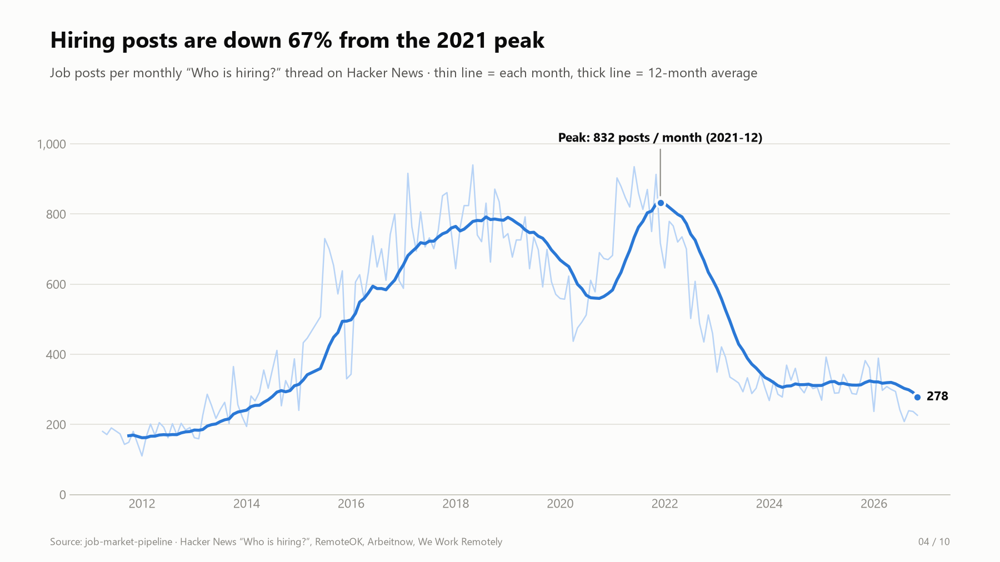
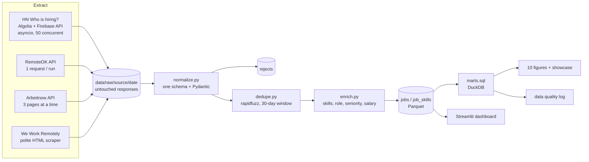

# job-market-pipeline

Fifteen years of tech hiring, collected from four job boards, cleaned into one table and
turned into findings. **Start with the showcase: [reports/SHOWCASE.md](reports/SHOWCASE.md)**
(introduction, 10 figures and a dashboard tour).

**Live dashboard: <https://tech-hiring-2011-2026.streamlit.app>** — filter by source,
role, skill and year. (Hosted on Streamlit Community Cloud; it may take a few seconds to
wake up if nobody has visited recently.)

## Findings in brief

92,571 clean job posts from 102,126 requests and 273 MB of raw data, April 2011 – November 2026.
Long-run trends are from Hacker News "Who is hiring?" only.

| | Finding |
|---|---|
| Hiring volume | 12-month average peaked at 832 posts/month in Dec 2021; now 278, down 67% |
| Remote work | 13% of posts in 2011 → 29% in 2019 → 83% in 2022 → 54% in 2026 |
| AI | AI/ML mentions flat near 18% until 2022, then 60% in 2026; LLM/agent terms 0% → 25% |
| Languages | Python 17% → 26%, TypeScript 0% → 24%; JavaScript 18% → 3%, Rails 17% → 3%, Java 13% → 4% |
| Pay transparency | 6% of posts stated a salary in 2019, 29% in 2026 |
| Pay by skill | Spark, distributed systems, PyTorch posts: $185–193k median vs about $152k without |
| Board mix | HN is 61% software engineering; We Work Remotely has more sales/support (29%) than software (17%) |



## Architecture



| Folder | What lives there |
|---|---|
| `collectors/` | `hn.py`, `remoteok.py`, `arbeitnow.py`, `wwr_scraper.py`, shared `common.py` |
| `transform/` | `normalize.py`, `dedupe.py`, `enrich.py`, `skills.yaml`, `geo.py`, `run.py` |
| `analytics/` | `marts.sql` – the analytics tables |
| `dashboard/` | `app.py` – Streamlit dashboard over the processed tables |
| `reports/` | `build_figures.py`, `capture_dashboard.py` (dashboard screenshots), `figures/*.png`, `SHOWCASE.md` |
| `data/raw/` | untouched responses, `{source}/{YYYY-MM-DD}/` (gitignored) |
| `data/processed/` | `jobs`, `job_skills`, `rejects`, `duplicate_pairs`, `marts/*`, quality log |
| `.github/workflows/daily.yml` | daily cron |

## Run it

```powershell
conda create -n jobmarket -c conda-forge python=3.12 pip -y
conda activate jobmarket
pip install -r requirements.txt

python -m collectors.hn             # one-off backfill, then cheap top-ups
python -m collectors.remoteok
python -m collectors.arbeitnow --max-pages 12
python -m collectors.wwr_scraper

python -m transform.run             # raw -> parquet -> marts -> quality log (offline)
python -m reports.build_figures     # parquet -> reports/figures/*.png
streamlit run dashboard/app.py      # interactive dashboard: source, role, skill, date filters
```

Everything after the collectors reads only `data/raw/`, so the cleaning and analysis can be
rerun as often as you like without touching any website again.

## Running plan and data budget

| Source | First run | Each daily run | Why |
|---|---|---|---|
| Hacker News | whole backfill, 2011 → today, about 130k requests in under an hour | only threads younger than 45 days are refetched (≈1 MB) | old threads never change; finished threads are skipped |
| We Work Remotely | ≈1,000 job pages at 1–2 s each (≈30 min) | 10 category pages + only the job pages not seen before | job pages are cached forever; category pages are the daily "still listed?" snapshot |
| Arbeitnow | 12 pages (3,600 listings) | same | newest-first API, 12 pages covers more than a day of postings |
| RemoteOK | 1 request | 1 request | the API returns the latest ~100 jobs |

The raw footprint after the first run and its growth per day are in the showcase and in
`data/processed/quality_latest.json`. `collectors/hn.py --max-mb` is a hard stop if you
need to cap disk use.

Daily snapshots are what make `first_seen` / `last_seen` meaningful: after a couple of
weeks, `listing_duration` in the marts tells you how long a job stays open.

## Data ethics

* **APIs first.** Three of four sources are official or public APIs. HN's Firebase API has
  no rate limit; I still cap concurrency at 50 and back off on errors.
* **The scraper is deliberately slow.** `wwr_scraper.py` parses `robots.txt` in code and
  refuses disallowed paths, makes one request at a time with a 1–2 s randomised pause,
  and never refetches a page it already has. ~1,000 pages take half an hour on purpose.
* **Honest User-Agent.** Every request identifies the project. Set `JOBMARKET_CONTACT`
  (an email or URL) to add contact details so a site owner can reach you; it is read from
  the environment so it never lands in git.
* **Attribution.** RemoteOK and Arbeitnow ask for a link back; the `url` column always
  points at the original listing, and neither site's content is republished here –
  only aggregates.
* **No personal data.** Only job adverts are stored. HN usernames in the raw files are not
  carried into the processed tables.
* **Raw data stays local.** `data/raw/` is gitignored.

## Known limits

* HN titles are extracted from free text; posts with several roles keep the first ones found.
* Salary figures come from the minority of posts that state one, and are converted with a
  fixed exchange-rate table (`transform/enrich.py`), not historical rates.
* Skill matching is dictionary-based: a company *named* Snowflake counts as a Snowflake
  mention. Ambiguous names (Go, R, C) use hand-written context rules.
* RemoteOK, Arbeitnow and WWR only have data from the day collection started; every
  long-run trend is Hacker News only.
