[English](SHOWCASE.md)

<div dir="rtl">

# خمسة عشر عامًا من التوظيف التقني، مقروءة من أربع منصات توظيف

*مشروع خط بيانات: جمع ← تنظيف ← إثراء ← تحليل. جُمعت البيانات في 24 نوفمبر 2026.*

## مقدمة

إعلانات الوظائف من السجلات العامة القليلة المحدَّثة باستمرار التي تكشف ما يريده أصحاب العمل
فعلًا: أي المهارات، وفي أي مكان، وبأي أجر، وهل عليك الحضور إلى
مكتب. المشكلة أن هذا السجل موزع على منصات تنشره كلٌّ بطريقتها،
وأن أغنى مصدر ممتد عبر الزمن — الخيط الشهري *«Ask HN: Who is hiring?»*
على Hacker News — نصٌّ حر يكتبه آلاف الأشخاص المختلفين.

يبني هذا المشروع البنية اللازمة لتحويل هذه الفوضى إلى إجابات. أربعة مُجمِّعات تسحب البيانات
من Hacker News وRemoteOK وArbeitnow وWe Work Remotely، ويستخدم كلٌّ منها نمط الوصول
الذي يحتمله مصدره. تُخزَّن كل استجابة كما وصلت دون تعديل، بحيث يمكن إعادة تشغيل كل
المراحل اللاحقة دون الاتصال بأي موقع مرة أخرى. ثم تُحوَّل المادة الخام
إلى جدول `jobs` واحد، ويُتحقَّق منها صفًا صفًا، ويُفحص ظهور الوظيفة نفسها على
عدة منصات، وتُثرى بالمهارات وعائلة الدور والأقدمية وراتب محوَّل
إلى دولارات أمريكية سنوية.

النتيجة **92,571 إعلان وظيفة نظيفًا من 102,126 طلب HTTP و273 ميغابايت من البيانات
الخام، تغطي الفترة من أبريل 2011 إلى نوفمبر 2026**. تعرض الرسوم العشرة أدناه أولًا *ما الذي
بُني* (1–3) ثم *ما تقوله البيانات* (4–10)؛ وبعدها تأخذك ست لقطات شاشة في جولة داخل
لوحة المعلومات.

الصور هي العرض الثابت للعناوين الرئيسية. ولكل ما لا تجيب عنه — مهارة
أخرى، أو عائلة أدوار واحدة، أو الوظائف عن بُعد فقط، أو فترة أضيق — تغذي الجداول نفسها
**لوحة معلومات تفاعلية مبنية بـ Streamlit** فيها مرشحات للمصدر والدور والمهارة والفترة الزمنية
(الجزء 3، مع لقطات شاشة لكل ميزة).

ملاحظة حول قراءة النتائج: الاتجاهات طويلة الأمد مأخوذة من Hacker News وحده، لأنه
المصدر الوحيد الذي له تاريخ. وهو يميل نحو الشركات الناشئة وهندسة البرمجيات،
وما يحصيه هو *الإعلانات*، لا الوظائف ولا التعيينات. أما المنصات الثلاث الأخرى فلديها يوم
واحد من البيانات حتى الآن؛ وتُستخدم للمقارنة بين المنصات في الرسم 10.

---

## الجزء 1 — ما الذي بُني

### 1. المشروع في لمحة

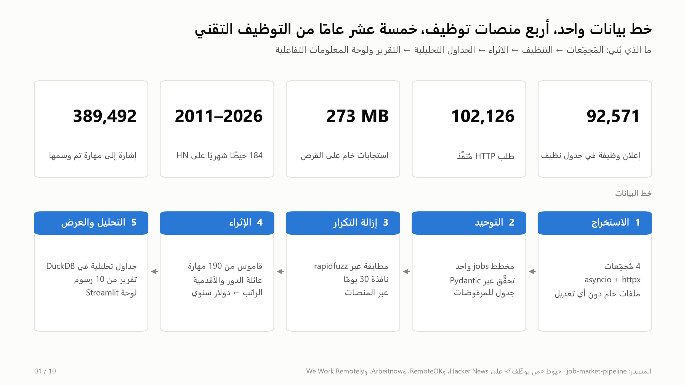

خمس مراحل، كلٌّ منها وحدة Python صغيرة، تنتهي بمخرَجين: هذا التقرير ولوحة
المعلومات. طبقة البيانات الخام هي قرار التصميم المهم:
لأن المُجمِّعات لا تكتب إلا الاستجابات كما وصلت إلى `data/raw/{source}/{date}/`،
فإن خطأً في شيفرة التنظيف يكلّف إعادة تشغيل، لا 100,000 طلب إضافي.

### 2. كيف جُمعت البيانات

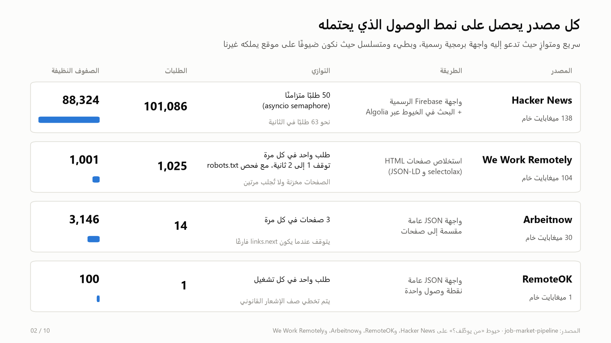

جلبُ أرشيف Hacker News هو استعراض القدرة على التوسع: 185 خيطًا شهريًا و100,600
تعليق جُلبت في نحو 27 دقيقة بمعدل 63 طلبًا في الثانية، مع 50 طلبًا
جاريًا في آن واحد و**صفر طلبات فاشلة**. أما We Work Remotely فهو النقيض عن قصد.
إنه موقع ويب لا واجهة برمجية، لذا تقرأ أداة الاستخلاص `robots.txt` أولًا، وترسل طلبًا واحدًا
في كل مرة، وتنتظر ثانية إلى ثانيتين بين الطلبات، ولا تجلب الصفحة نفسها مرتين أبدًا.
استغرقت ألف صفحة نحو 35 دقيقة، وهذا هو المقصود بالضبط.

### 3. تنظيف أصعب المصادر

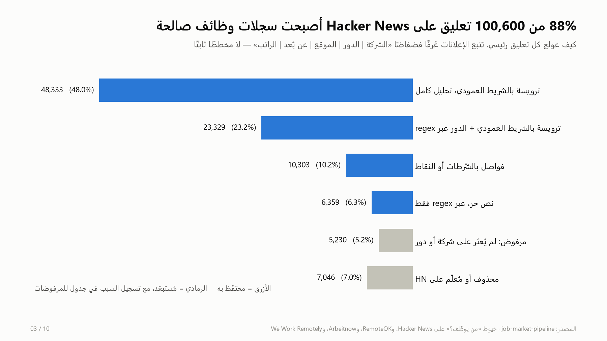

تتبع إعلانات Hacker News عُرفًا لا مخططًا ثابتًا. نحو 71% منها تبدأ بترويسة مفصولة
بالشريط العمودي (`Company | Role | Location | Remote | Salary`) يمكن تقسيمها وتصنيف
مقاطعها واحدًا تلو الآخر؛ وفي ثلث هذه الإعلانات كان لا بد من استخراج الدور من
نص الإعلان باستخدام تعبير نمطي (regex). و10% أخرى تستخدم الشَّرطات أو النقاط بدلًا من ذلك (وهي أكثر شيوعًا بكثير
في السنوات الأولى)، و6% نثر حر يُعالَج بالتعبيرات النمطية وحدها. وإجمالًا **أصبح 88% من التعليقات
سجلات وظائف**. ولم تُسقَط نسبة الـ 12% المتبقية بصمت: 7% منها كانت محذوفة أو
مُعلَّمة على Hacker News نفسه، و5% لم تتضمن شركة أو دورًا يمكن تحديده (معظمها
أسئلة وتعليقات جانبية). ويُخزَّن كل صف مرفوض مع سبب رفضه.

---

## الجزء 2 — ما تقوله البيانات

### 4. حجم التوظيف ثلث ذروته في 2021

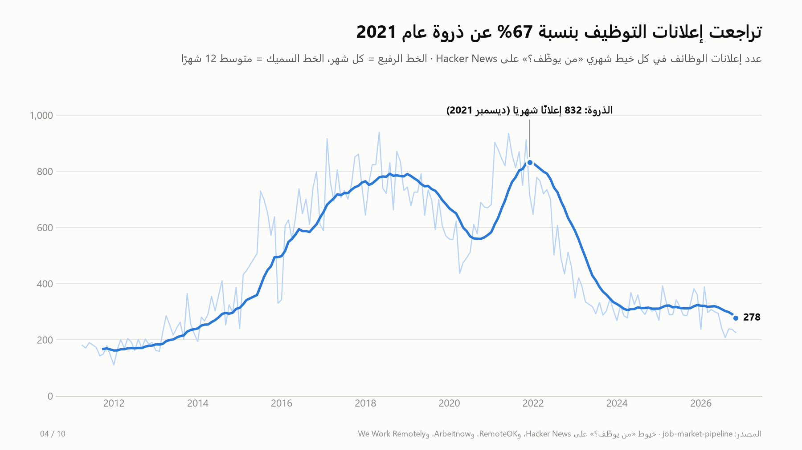

ارتفع متوسط 12 شهرًا من نحو 170 إعلانًا شهريًا في 2011 إلى قرابة 790 في
2018، وانخفض حين ضربت الجائحة، ثم قفز إلى **832 في ديسمبر 2021**. بعد ذلك تراجع
طوال عامين، واستقر قرب 300 منذ منتصف 2023؛ وآخر قراءة هي **278، بانخفاض 67%
عن الذروة**، أي عاد إلى مستويات 2014. قد يعود جزء من ذلك إلى انتقال أصحاب العمل إلى قنوات
أخرى، فاقرأه على أنه «إعلانات أقل في هذا المكان»، لكن التوقيت يتطابق مع التباطؤ الأوسع
في التوظيف التقني.

### 5. العمل عن بُعد قفز، ثم استقر عند النصف تقريبًا

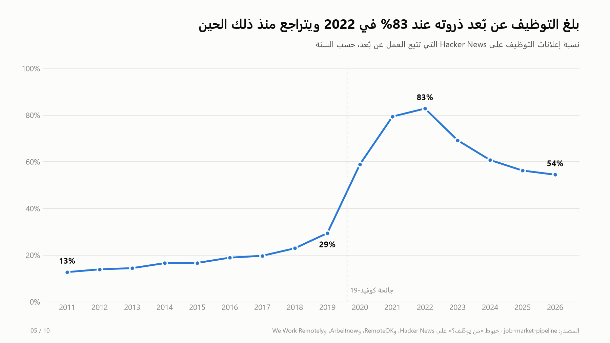

خلال معظم سنوات العقد الممتد من 2010 إلى 2019 زادت الوظائف عن بُعد ببطء، من 13% من الإعلانات في 2011 إلى 29% في
2019. ثم ضغطت الجائحة عقدًا من التغيير في عامين: **83% بحلول 2022**. ومنذ
ذلك الحين تتراجع النسبة كل عام، حتى بلغت **54% في 2026** — تراجع واضح، لكنها لا تزال
قرابة ضعف مستوى ما قبل الجائحة. العمل عن بُعد لم يختفِ؛ لكنه لم يعد
الخيار الافتراضي.

### 6. تبدّل الحرس في لغات البرمجة

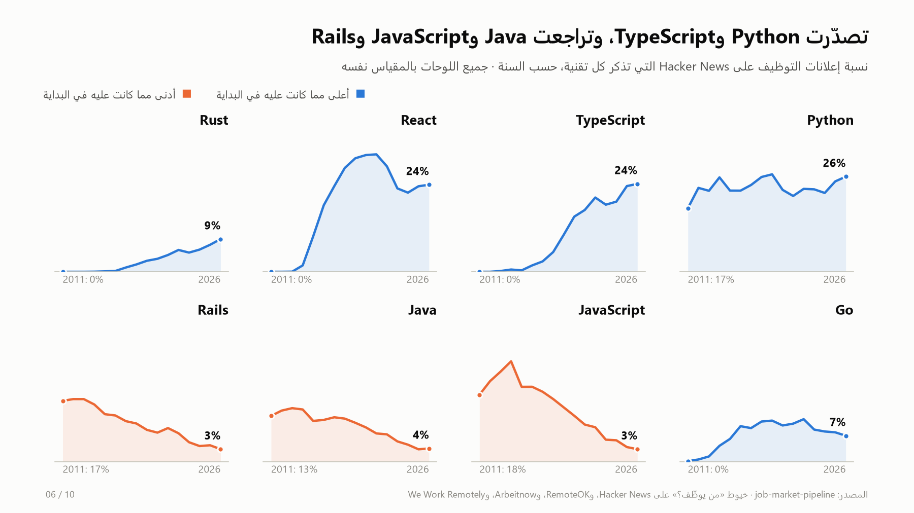

Python هي الرابح الثابت، إذ وردت في 17% من الإعلانات في 2011 و26% الآن. وانتقلت TypeScript من
لا شيء إلى 24% وأخذت مكان JavaScript بدقة تقريبًا: إذ هبطت «JavaScript» المجردة من
ذروة 28% إلى 3%. وتراجع Ruby on Rails، الذي كان في إعلان من كل ستة في 2011، إلى 3%،
وJava من 13% إلى 4%. وبلغت React ذروتها عند 32% في 2020–2021 ثم هدأت إلى 24%. أما Rust فهي
الصاعدة ببطء وثبات، وتبلغ الآن 9%، وقد تجاوزت Go (7%).

### 7. الذكاء الاصطناعي يظهر الآن في ستة من كل عشرة إعلانات

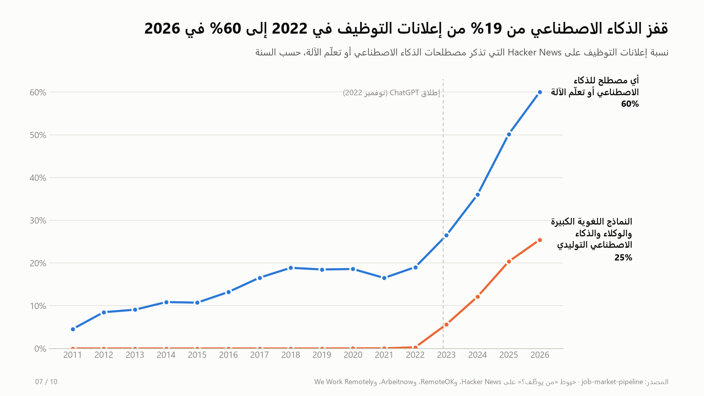

ظلت الإشارات إلى الذكاء الاصطناعي أو تعلّم الآلة مستقرة بين 17% و19% من 2017 إلى 2022. وبعد إطلاق
ChatGPT ارتفعت إلى **60% في 2026**. أما المفردات الأحدث — النماذج اللغوية الكبيرة، والوكلاء، والذكاء
الاصطناعي التوليدي، والتوليد المعزَّز بالاسترجاع — فانتقلت من الصفر عمليًا إلى **25%** من الإعلانات في
أربع سنوات. هذا إحصاء للإشارات لا للمسميات الوظيفية: كثير منها أدوار هندسية
عادية في شركات باتت تصف نفسها بأنها شركات ذكاء اصطناعي.

### 8. ذكر الراتب يصبح أمرًا معتادًا

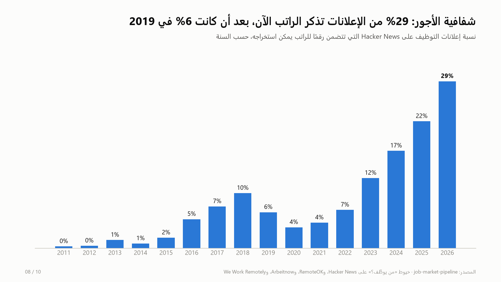

في 2019 لم يتضمن رقمًا للراتب سوى 6% من الإعلانات؛ وفي 2026 بلغت النسبة **29%**، وقد
ارتفعت كل عام منذ 2020. والمحركات المرجحة هي قوانين شفافية الأجور في عدة ولايات أمريكية
والتحول إلى التوظيف عن بُعد عبر المناطق. وارتفع الراتب الوسيط
المُعلَن بين الإعلانات التي تذكره من 120 ألف دولار في 2019 إلى 175 ألفًا في 2026، لكن تلك
المقارنة مهزوزة: فنوع الشركات التي تفصح عن الأجر تغيّر مع نمو النسبة.

### 9. أي المهارات تقترن بأجور مُعلَنة أعلى

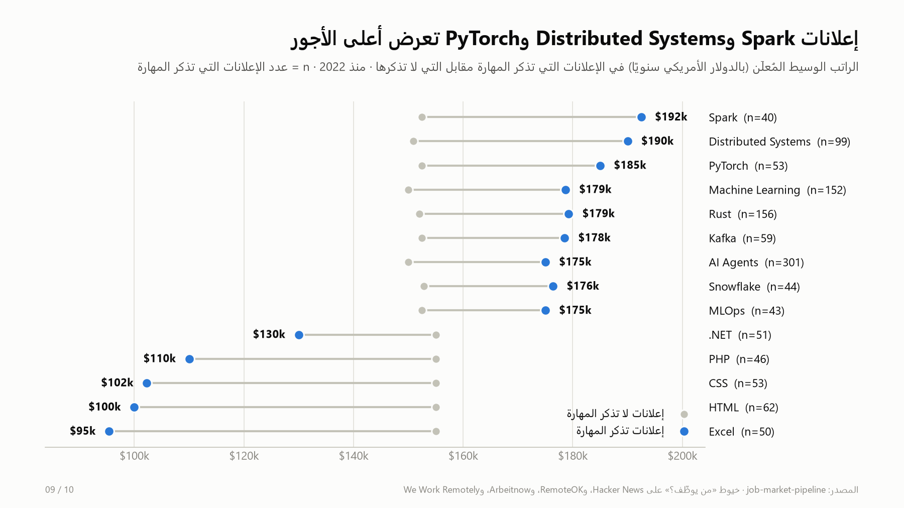

بين الإعلانات المنشورة منذ 2022 والتي تذكر الراتب، تعرض الإعلانات التي تذكر Spark أو الأنظمة الموزعة
أو PyTorch أجورًا وسيطة تبلغ **185–193 ألف دولار**، مقابل نحو **152 ألفًا** للإعلانات التي لا
تذكرها. وتأتي Rust وKafka وتعلّم الآلة بعدها بقليل. وفي الطرف الآخر، تعرض الإعلانات
التي تذكر HTML أو CSS أو PHP أو Excel ما بين 95 و110 آلاف دولار. هذا ارتباط لا سببية:
فهذه المهارات تدل على أدوار بنية تحتية وتعلّم آلة رفيعة المستوى، وهي أعلى أجرًا أيًّا كانت الأداة.
أحجام العينات صغيرة (موضحة بجانب كل مهارة)، لذا تعامل مع الترتيب على أنه استرشادي.

### 10. كل منصة تُظهر سوقًا مختلفة

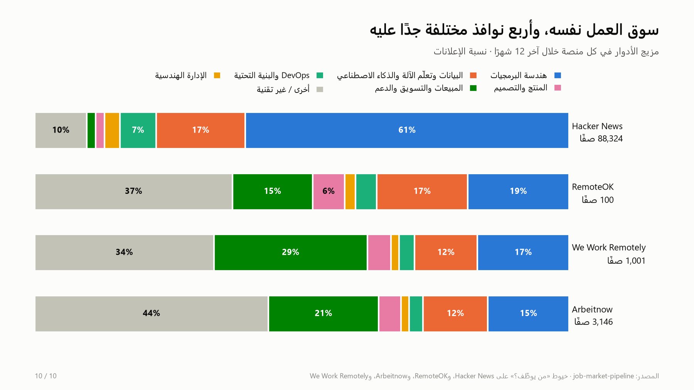

Hacker News هندسي في الغالب الساحق: 61% أدوار برمجية و17% بيانات وتعلّم آلة وذكاء اصطناعي.
أما المنصات الثلاث الأخرى فأوسع بكثير. ففي We Work Remotely تفوق أدوار المبيعات والتسويق والدعم
(29%) أدوار هندسة البرمجيات (17%)؛ وArbeitnow، وهي منصة متمركزة في ألمانيا، 44% من أدوارها
خارج المجال التقني تمامًا. ومن يستخلص استنتاجات عن «سوق العمل» من
منصة واحدة إنما يصف تلك المنصة. ويستند عمود RemoteOK إلى 100 إعلان فقط
وسيترسخ مع تراكم التشغيلات اليومية.

---

## جودة البيانات في جدول واحد

| المصدر | البيانات الخام | الصفوف النظيفة | المرفوضة | فترة الإعلانات |
|---|---|---|---|---|
| Hacker News | 138 ميغابايت | 88,324 | 12,276 (7,046 محذوفة على HN، و5,230 تعذّر تحليلها) | أبريل 2011 – نوفمبر 2026 |
| We Work Remotely | 104 ميغابايت | 1,001 | 1 | المنشورة حاليًا |
| Arbeitnow | 30 ميغابايت | 3,146 | 0 | 17–24 نوفمبر 2026 |
| RemoteOK | 1 ميغابايت | 100 | 0 | 20–23 نوفمبر 2026 |

عثرت المطابقة بين المنصات على 101 زوج مكرر، كلها تقريبًا بين We Work Remotely
وArbeitnow وRemoteOK. والسجل الكامل، بما في ذلك معدلات القيم المفقودة لكل عمود، موجود في
`data/processed/quality_latest.json`.

## ما لا تستطيع البيانات إخبارك به بعد

* **كم تبقى الوظائف مفتوحة.** الحقلان `first_seen` و`last_seen` جاهزان، لكن ذلك يتطلب
  عدة أسابيع من اللقطات اليومية. سير العمل اليومي مكتوب، لكنه لم يعمل بعد.
* **الاتجاهات خارج Hacker News.** المنصات الأخرى تبدأ اليوم.
* **الأجر الحقيقي في السوق.** الرواتب مأخوذة من 7.5% من إعلانات Hacker News التي تذكر الراتب،
  ومحوَّلة باستخدام جدول ثابت لأسعار الصرف.
* **الطلب الدقيق على المهارات.** المطابقة قائمة على القاموس، لذا فإن شركة *اسمها* Snowflake
  تُحتسب إشارةً إلى Snowflake، والإعلان الذي يسرد خمسة أدوار يُحتسب مرة واحدة.

## الجزء 3 — لوحة المعلومات

تجيب الرسوم العشرة عن الأسئلة التي اخترتُها أنا. أما لوحة المعلومات فتتيح للقارئ أن يطرح أسئلته الخاصة.
إنها صفحة Streamlit واحدة فوق جداول Parquet نفسها، وتُعاد حسابات كل لوحة
عند تغيير أي مرشح. كل عرض أدناه هو نقطة وصول (endpoint) في التطبيق المنشور:
المرشحات محفوظة في العنوان، لذا يمكن فتح كل لقطة شاشة كما تظهر.

**مباشرة: <https://tech-hiring-2011-2026.streamlit.app>** (مستضافة على Streamlit Community
Cloud؛ وقد تستغرق بضع ثوانٍ حتى تستيقظ إذا لم يزرها أحد مؤخرًا). ولتشغيلها
محليًا بدلًا من ذلك:

</div>

```powershell
streamlit run dashboard/app.py
```

<div dir="rtl">

لقطات الشاشة أدناه مأخوذة من لوحة المعلومات الإنجليزية الحية.

### أ. نظرة عامة: المرشحات والأرقام الرئيسية

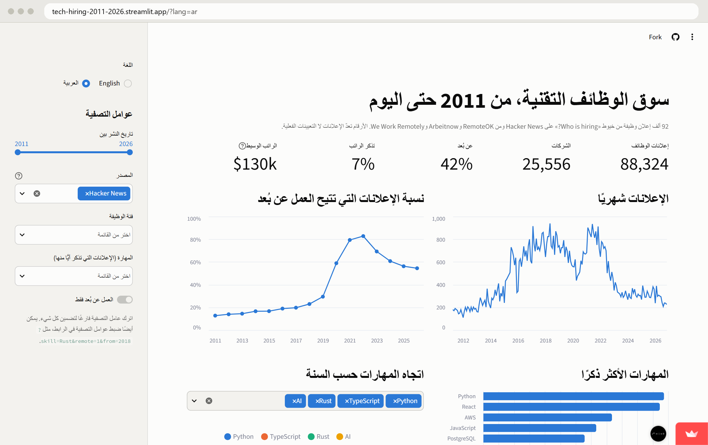

نقطة الوصول: [`https://tech-hiring-2011-2026.streamlit.app/?lang=ar`](https://tech-hiring-2011-2026.streamlit.app/?lang=ar)

* **المرشحات (يسار الصفحة).** نطاق السنوات، والمصدر، وعائلة الدور، والمهارة، ومفتاح «عن بُعد فقط».
  المرشح الفارغ يعني «الكل». ومرشح المهارات يحتفظ بالإعلانات التي تذكر *أيًّا* من
  المهارات المختارة.
* **الأرقام الرئيسية.** عدد الإعلانات، والشركات المتمايزة، ونسبة العمل عن بُعد، ونسبة الإعلانات التي
  تذكر الراتب، والراتب الوسيط المُعلَن (لا يظهر إلا إذا كان لدى 20 إعلانًا على الأقل
  راتب مذكور). ومن دون مرشحات: 88,324 إعلانًا على Hacker News من 25,556 شركة.
* **الإعلانات شهريًا** و**نسبة العمل عن بُعد حسب السنة** هما النسختان التفاعليتان من
  الرسمين 4 و5؛ وتمرير المؤشر فوق نقطة يُظهر قيمتها الدقيقة.
* تُفتح الصفحة على Hacker News وحده. فالمنصات الثلاث الأخرى لديها يوم واحد من البيانات،
  ودمجها كان سيضع قفزة زائفة في نهاية كل خط اتجاه.

### ب. المهارات: ما المطلوب، وكيف تغيّر ذلك

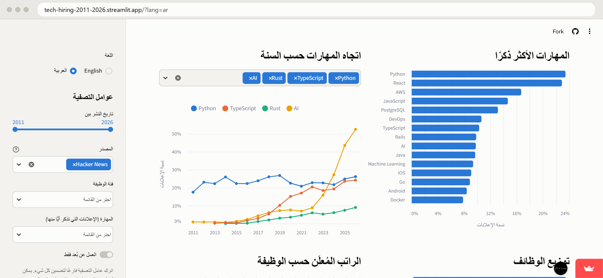

نقطة الوصول: [`https://tech-hiring-2011-2026.streamlit.app/?lang=ar`](https://tech-hiring-2011-2026.streamlit.app/?lang=ar) (نقطة الوصول نفسها، بعد التمرير إلى صف المهارات)

* **المهارات الأكثر ذكرًا** ترتّب أعلى 15 مهارة لما هو مُصفّى حاليًا، كنسبة
  من الإعلانات.
* **اتجاه المهارة حسب السنة** يقارن ما يصل إلى أربع مهارات من اختيارك. ويعرض العرض الافتراضي
  قصة الرسمين 6 و7 في مخطط واحد: Python ثابتة، وTypeScript وRust
  في صعود، والذكاء الاصطناعي يتجاوز كل شيء بعد 2023.

### ج. الأدوار والأجور

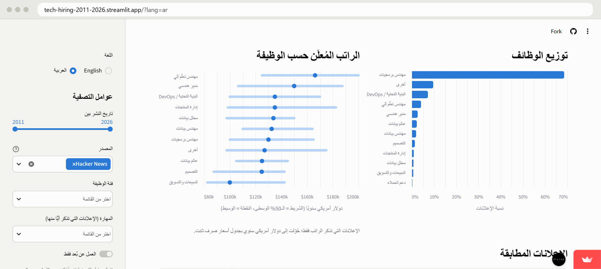

نقطة الوصول: [`https://tech-hiring-2011-2026.streamlit.app/?lang=ar`](https://tech-hiring-2011-2026.streamlit.app/?lang=ar) (نقطة الوصول نفسها، بعد التمرير إلى صف الأدوار)

* **مزيج الأدوار** يبيّن عائلات الأدوار التي تنتمي إليها الإعلانات المُصفّاة.
* **الراتب المُعلَن حسب الدور** يرسم الوسيط (نقطة) والنصف الأوسط من الإعلانات
  (شريط) لكل دور لديه 20 إعلانًا على الأقل بها راتب. وإظهار التشتت مهم هنا:
  فالنطاقات تتداخل أكثر بكثير مما توحي به الأوساط وحدها.

### د. المرشحات أثناء العمل

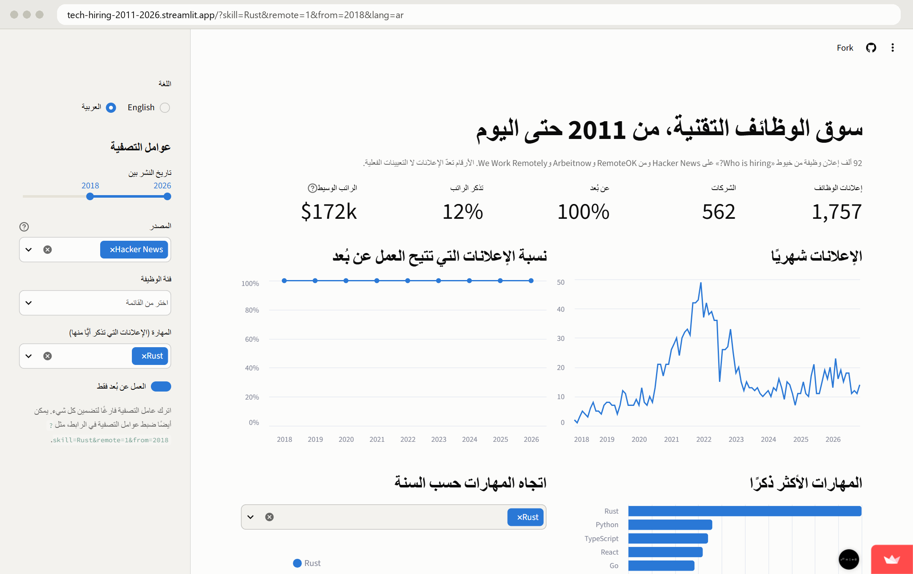

نقطة الوصول: [`https://tech-hiring-2011-2026.streamlit.app/?skill=Rust&remote=1&from=2018&lang=ar`](https://tech-hiring-2011-2026.streamlit.app/?skill=Rust&remote=1&from=2018&lang=ar)

الصفحة نفسها بعد تضييقها إلى *الإعلانات عن بُعد التي تذكر Rust منذ 2018*: 1,757 إعلانًا من
562 شركة، 12% منها تذكر الراتب، بوسيط 172 ألف دولار مقابل 130 ألفًا للمجموعة
غير المُصفّاة. كل مخطط، بما في ذلك قائمة المهارات (ما الذي تطلبه فرق Rust أيضًا)، يتبع
المرشح.

وهذا العرض رابطٌ أيضًا. فالمرشحات تُقرأ من العنوان، لذا يمكن حفظ أي عرض
في المفضلة أو مشاركته:

</div>

```
https://tech-hiring-2011-2026.streamlit.app/?skill=Rust&remote=1&from=2018&lang=ar
```

<div dir="rtl">

المعاملات المقبولة: `from` و`to` (سنوات)، و`source` (`hn` و`wwr` و`arbeitnow`
و`remoteok`)، و`role`، و`skill` (مفصولة بفواصل)، و`remote=1`.

### هـ. العودة إلى المصدر

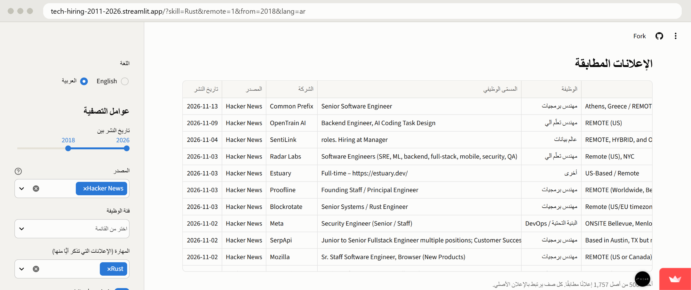

نقطة الوصول: [`https://tech-hiring-2011-2026.streamlit.app/?skill=Rust&remote=1&from=2018&lang=ar`](https://tech-hiring-2011-2026.streamlit.app/?skill=Rust&remote=1&from=2018&lang=ar) (بعد التمرير إلى الجدول)

أحدث 500 إعلان مطابق، قابلة للفرز والبحث، مع الشركة والمسمى والدور
والموقع وعلامة العمل عن بُعد والراتب. كل صف يرتبط بالإعلان الأصلي، ما يُبقي
المجاميع قابلة للتحقق ويلبي طلب المنصات بوضع رابط إليها.

### و. مقارنة المنصات

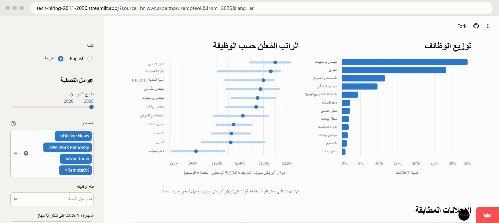

نقطة الوصول: [`https://tech-hiring-2011-2026.streamlit.app/?source=hn,wwr,arbeitnow,remoteok&from=2026&lang=ar`](https://tech-hiring-2011-2026.streamlit.app/?source=hn,wwr,arbeitnow,remoteok&from=2026&lang=ar)

اختيار المصادر الأربعة كلها لعام 2026 يعطي النسخة الحية من الرسم 10: فبمجرد إضافة
المنصات العامة، تحتل أدوار المبيعات والتسويق والدعم والأدوار غير التقنية
جزءًا كبيرًا من المزيج، وتكتسب لوحة الرواتب أدوارًا مثل دعم العملاء التي
تكاد لا توجد على Hacker News.

لقطات الشاشة مأخوذة من التطبيق المنشور لا من تشغيل محلي، ويحمل كلٌّ منها
نقطة الوصول التي أنتجته في شريط العنوان. وهي مُولَّدة لا ملتقطة يدويًا:
يفتح الأمر `python -m reports.capture_dashboard` كل نقطة وصول في متصفح Edge دون واجهة ويحفظ
الصور، بحيث يمكن تحديثها بعد كل تشغيل لخط البيانات.

## إعادة الإنتاج

</div>

```powershell
python -m transform.run
```

```powershell
python -m reports.build_figures
python -m reports.build_figures_ar
```

<div dir="rtl">

كلا الأمرين يقرأ ملفات محلية فقط؛ ويرسم `build_figures_ar.py` النسخ العربية من الرسوم في `reports/figures_ar/`.
راجع [README](../README.ar.md) لأوامر الجمع، وخطة التشغيل، وملاحظات أخلاقيات البيانات.

</div>
