# Fifteen years of tech hiring, read from four job boards

*A data pipeline project: collect → clean → enrich → analyse. Data collected 24 November 2026.*

## Introduction

Job adverts are one of the few public, continuously updated records of what employers
actually want: which skills, where, for how much, and whether you have to show up at an
office. The catch is that the record is scattered across boards that all publish it
differently, and the richest long-running source — the monthly *"Ask HN: Who is hiring?"*
thread on Hacker News — is free text typed by thousands of different people.

This project builds the plumbing to turn that mess into answers. Four collectors pull
from Hacker News, RemoteOK, Arbeitnow and We Work Remotely, each using the access
pattern its source can tolerate. Every response is stored untouched, so everything
downstream can be rerun without touching a website again. The raw material is then
mapped into one `jobs` table, validated row by row, checked for the same job appearing on
several boards, and enriched with skills, role family, seniority and a salary converted
to annual US dollars.

The result is **92,571 clean job posts from 102,126 HTTP requests and 273 MB of raw
data, covering April 2011 to November 2026**. The ten figures below show first *what was
built* (1–3) and then *what the data says* (4–10); six screenshots then walk through the
dashboard.

The pictures are the fixed, headline view. For anything they do not answer — a different
skill, one role family, remote jobs only, a narrower period — the same tables feed an
**interactive Streamlit dashboard** with filters for source, role, skill and date range
(Part 3, with screenshots of each feature).

A note on reading the findings: the long-run trends come from Hacker News only, because
it is the only source with history. It skews towards startups and software engineering,
and it is a count of *adverts*, not of jobs or hires. The other three boards have a single
day of data so far; they are used for the cross-board comparison in figure 10.

---

## Part 1 — What was built

### 1. The project at a glance

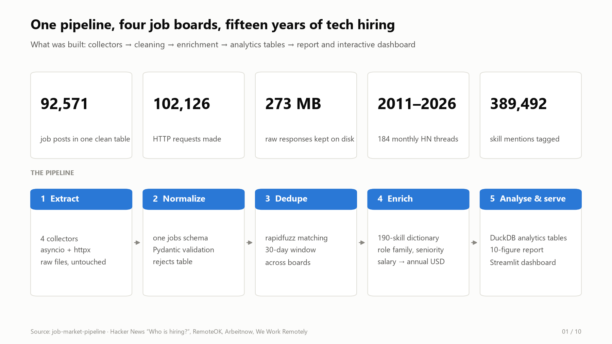

Five stages, each a small Python module, ending in two outputs: this report and a
dashboard. The raw layer is the important design decision:
because collectors only ever write untouched responses to `data/raw/{source}/{date}/`,
a bug in the cleaning code costs a rerun, not another 100,000 requests.

### 2. How the data was collected

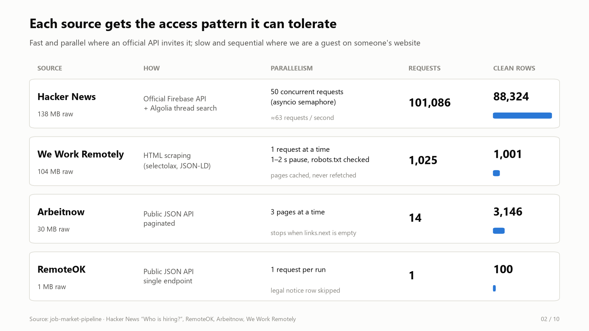

The Hacker News backfill is the scale showcase: 185 monthly threads and 100,600
comments fetched in about 27 minutes at 63 requests per second, with 50 requests in
flight at once and **zero failed requests**. We Work Remotely is the opposite on purpose.
It is a website, not an API, so the scraper reads `robots.txt` first, sends one request
at a time, waits 1–2 seconds between them and never fetches the same page twice. One
thousand pages took about 35 minutes, and that is the point.

### 3. Cleaning the hardest source

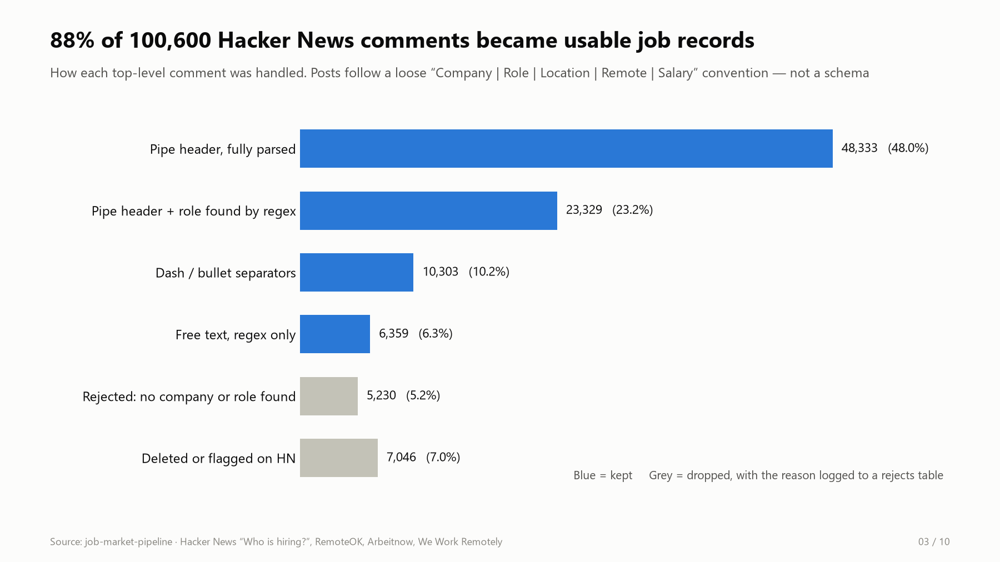

Hacker News posts follow a convention, not a schema. About 71% open with a pipe-separated
header (`Company | Role | Location | Remote | Salary`) that can be split and classified
segment by segment; for a third of those the role still had to be recovered from the
body with a regular expression. Another 10% use dashes or bullets instead (far more common
in the early years), and 6% are free prose handled by regex alone. In total **88% of comments became
job records**. The remaining 12% were not silently dropped: 7% had been deleted or
flagged on Hacker News itself, and 5% had no identifiable company or role (mostly
questions and meta-comments). Each rejected row is stored with its reason.

---

## Part 2 — What the data says

### 4. Hiring volume is a third of its 2021 peak

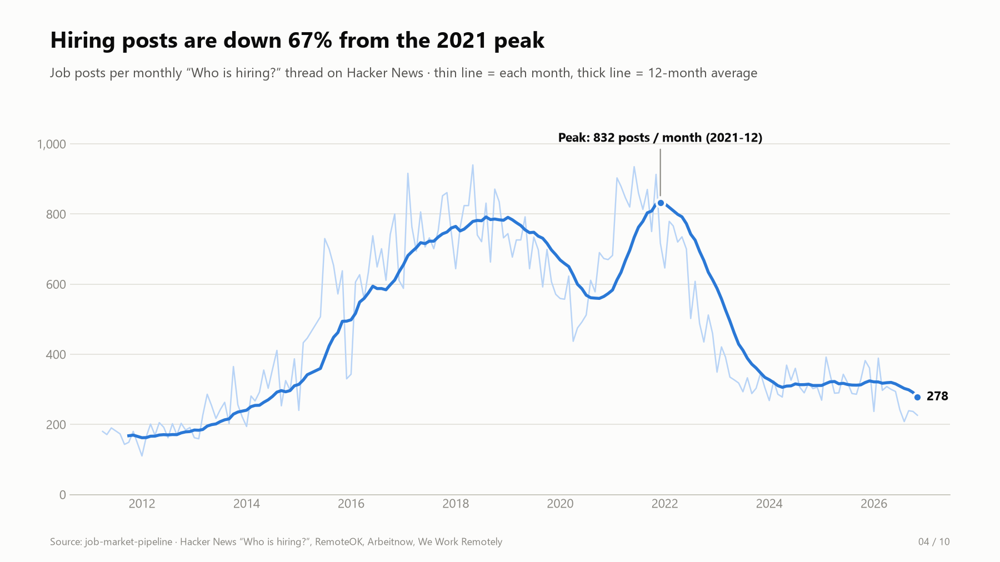

The 12-month average climbed from about 170 posts a month in 2011 to roughly 790 in
2018, dipped when the pandemic hit, then spiked to **832 in December 2021**. It then fell
for two years and has sat near 300 since mid-2023; the latest reading is **278, down 67%
from the peak** and back to 2014 levels. Part of this may be employers moving to other
channels, so read it as "fewer adverts in this venue", but the timing matches the wider
tech hiring slowdown.

### 5. Remote work surged, then settled at about half

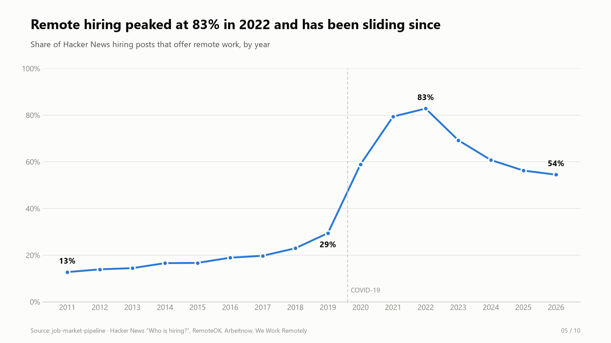

For most of the 2010s remote roles crept up slowly, from 13% of posts in 2011 to 29% in
2019. The pandemic compressed a decade of change into two years: **83% by 2022**. Since
then the share has fallen every year, to **54% in 2026** — a clear retreat, but still
nearly double the pre-pandemic level. Remote has not gone away; it has stopped being the
default.

### 6. The language guard has changed

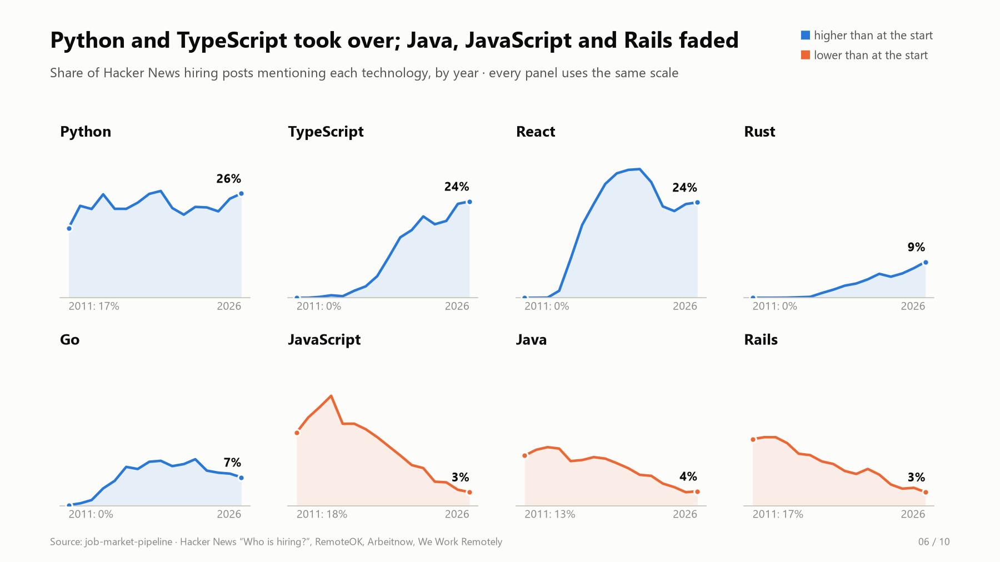

Python is the steady winner, in 17% of posts in 2011 and 26% now. TypeScript went from
nothing to 24% and took JavaScript's place almost exactly: plain "JavaScript" fell from
a 28% peak to 3%. Ruby on Rails, in one of every six posts in 2011, is down to 3%, and
Java from 13% to 4%. React peaked at 32% around 2020–21 and has eased to 24%. Rust is the
slow, consistent climber, now at 9%, and has overtaken Go (7%).

### 7. AI now appears in six of every ten posts

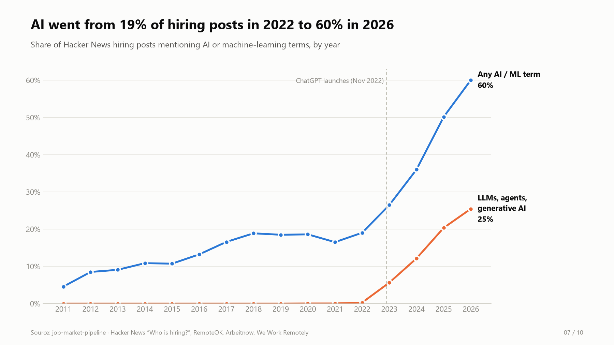

Mentions of AI or machine learning were flat at 17–19% from 2017 to 2022. After ChatGPT
launched they climbed to **60% in 2026**. The newer vocabulary — LLMs, agents, generative
AI, retrieval-augmented generation — went from effectively zero to **25%** of posts in
four years. This counts mentions, not job titles: many of these are ordinary engineering
roles at companies that now describe themselves as AI companies.

### 8. Stating the salary is becoming normal

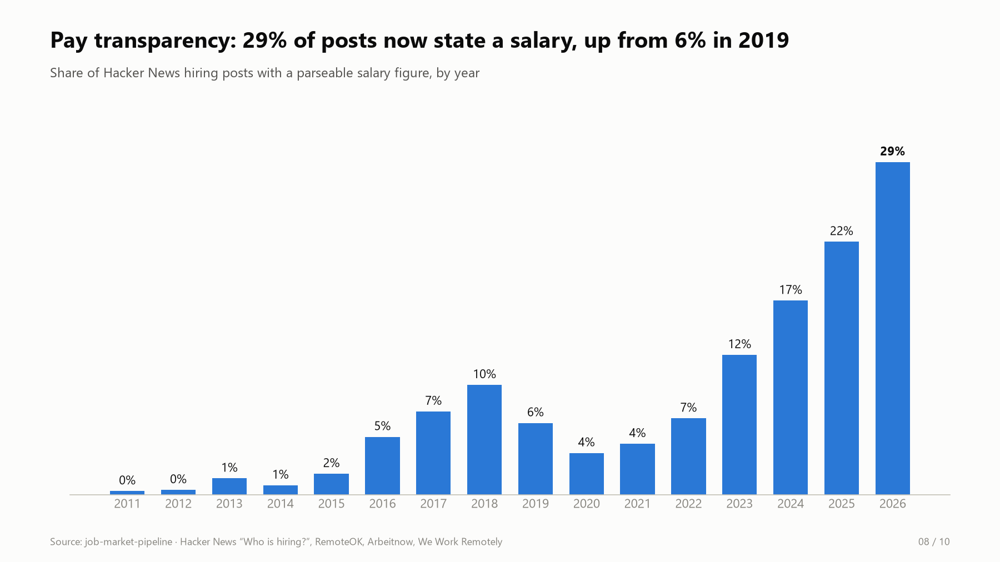

In 2019 only 6% of posts included a salary figure; in 2026 it is **29%**, and the share
has risen every year since 2020. Pay-transparency laws in several US states and the
shift to remote hiring across regions are the likely drivers. The median advertised
salary among posts that state one rose from $120k in 2019 to $175k in 2026, but that
comparison is shaky: the kind of company that discloses pay has changed as the share grew.

### 9. Which skills come with higher advertised pay

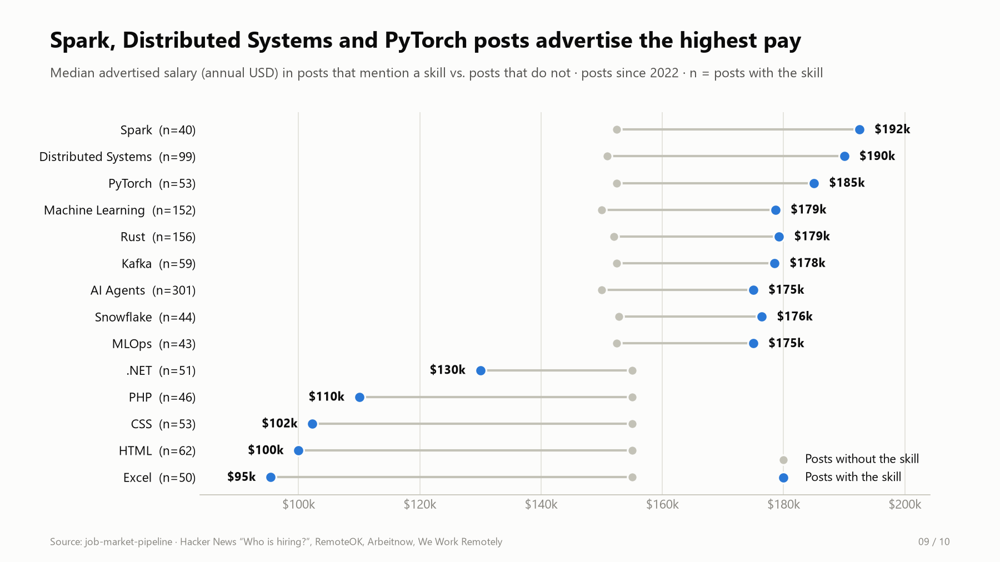

Among posts since 2022 that state a salary, those mentioning Spark, distributed systems
or PyTorch advertise medians of **$185–193k**, against about **$152k** for posts that do
not. Rust, Kafka and machine learning sit close behind. At the other end, posts
mentioning HTML, CSS, PHP or Excel advertise $95–110k. This is association, not cause:
these skills mark senior infrastructure and ML roles, which pay more whatever the tool.
Sample sizes are small (shown beside each skill), so treat the ordering as indicative.

### 10. Each board shows a different market

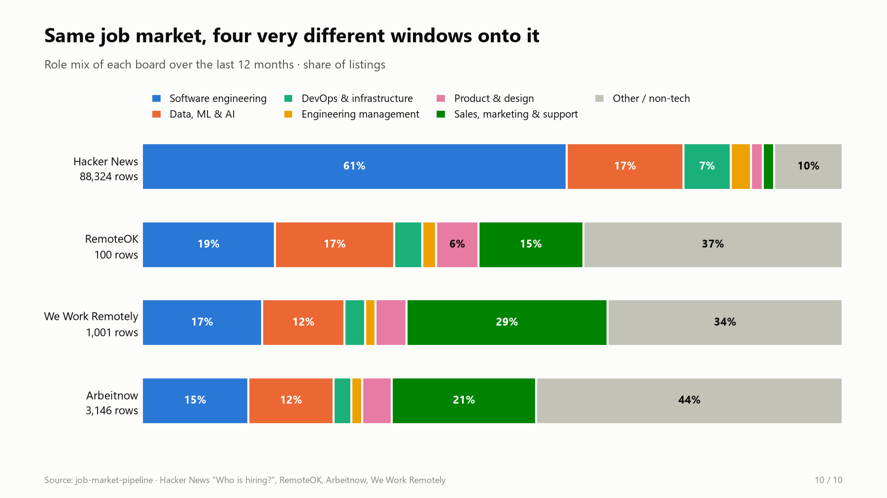

Hacker News is overwhelmingly engineering: 61% software roles and 17% data, ML and AI.
The other three are far broader. On We Work Remotely, sales, marketing and support
(29%) outnumber software engineering (17%); Arbeitnow, a German-centred board, is 44%
roles outside tech entirely. Anyone drawing conclusions about "the job market" from a
single board is describing that board. RemoteOK's bar rests on only 100 listings and
will firm up as daily runs accumulate.

---

## Data quality in one table

| Source | Raw data | Clean rows | Rejected | Posts covering |
|---|---|---|---|---|
| Hacker News | 138 MB | 88,324 | 12,276 (7,046 deleted on HN, 5,230 unparseable) | Apr 2011 – Nov 2026 |
| We Work Remotely | 104 MB | 1,001 | 1 | currently listed |
| Arbeitnow | 30 MB | 3,146 | 0 | 17–24 Nov 2026 |
| RemoteOK | 1 MB | 100 | 0 | 20–23 Nov 2026 |

Cross-board matching found 101 duplicate pairs, almost all between We Work Remotely,
Arbeitnow and RemoteOK. The full log, including missing-value rates per column, is in
`data/processed/quality_latest.json`.

## What this cannot tell you yet

* **How long jobs stay open.** `first_seen` and `last_seen` are in place, but that needs
  several weeks of daily snapshots. The daily workflow is written; it has not run yet.
* **Trends outside Hacker News.** The other boards start today.
* **True market pay.** Salaries come from the 7.5% of Hacker News posts that state one,
  converted with a fixed exchange-rate table.
* **Exact skill demand.** Matching is dictionary-based, so a company *named* Snowflake
  counts as a Snowflake mention, and a post listing five roles is counted once.

## Part 3 — The dashboard

The ten figures answer the questions I chose. The dashboard lets a reader ask their own.
It is a single Streamlit page over the same Parquet tables, and every panel recalculates
when a filter changes. Every view below is an endpoint of the deployed app: the
filters live in the address, so each screenshot can be opened as shown.

**Live: <https://tech-hiring-2011-2026.streamlit.app>** (hosted on Streamlit Community
Cloud; it can take a few seconds to wake if nobody has visited recently). To run it
locally instead:

```powershell
streamlit run dashboard/app.py
```

### A. Overview: filters and headline numbers

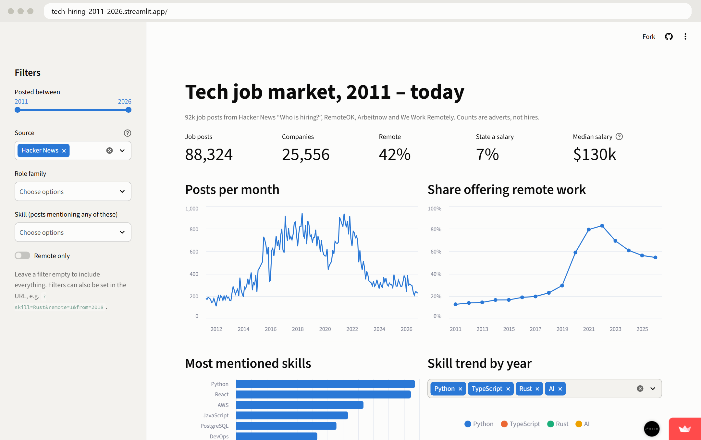

Endpoint: [`https://tech-hiring-2011-2026.streamlit.app/`](https://tech-hiring-2011-2026.streamlit.app/)

* **Filters (left).** Year range, source, role family, skill, and a "remote only" switch.
  An empty filter means "everything". The skill filter keeps posts that mention *any* of
  the chosen skills.
* **Headline numbers.** Posts, distinct companies, remote share, share of posts that
  state a salary, and the median advertised salary (shown only when at least 20 posts
  have one). With no filters: 88,324 Hacker News posts from 25,556 companies.
* **Posts per month** and **remote share by year** are the interactive versions of
  figures 4 and 5; hovering a point shows the exact value.
* The page opens on Hacker News only. The other three boards have one day of data, and
  mixing them in would put a false spike at the end of every trend line.

### B. Skills: what is asked for, and how that changed

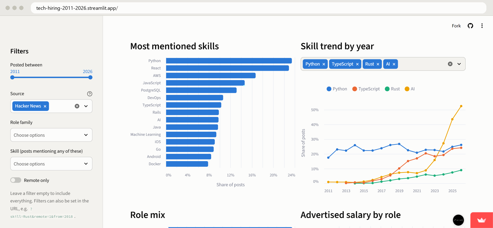

Endpoint: [`https://tech-hiring-2011-2026.streamlit.app/`](https://tech-hiring-2011-2026.streamlit.app/) (same endpoint, scrolled to the skills row)

* **Most mentioned skills** ranks the top 15 for whatever is currently filtered, as a
  share of posts.
* **Skill trend by year** compares up to four skills of your choice. The default view
  shows the story of figures 6 and 7 in one chart: Python steady, TypeScript and Rust
  climbing, AI overtaking everything after 2023.

### C. Roles and pay

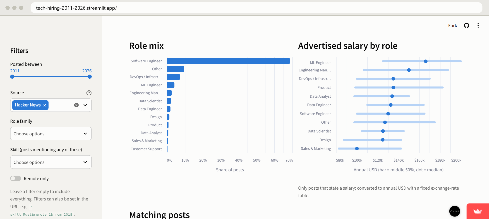

Endpoint: [`https://tech-hiring-2011-2026.streamlit.app/`](https://tech-hiring-2011-2026.streamlit.app/) (same endpoint, scrolled to the roles row)

* **Role mix** shows which role families the filtered posts belong to.
* **Advertised salary by role** draws the median (dot) and the middle 50% of posts
  (bar) for each role with at least 20 salaried posts. Showing the spread matters here:
  the ranges overlap far more than the medians alone suggest.

### D. Filters in action

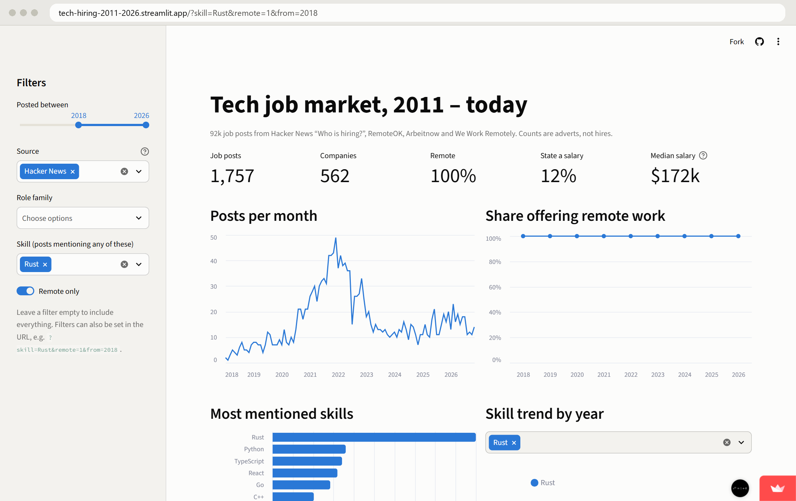

Endpoint: [`https://tech-hiring-2011-2026.streamlit.app/?skill=Rust&remote=1&from=2018`](https://tech-hiring-2011-2026.streamlit.app/?skill=Rust&remote=1&from=2018)

The same page narrowed to *remote posts mentioning Rust since 2018*: 1,757 posts from
562 companies, 12% stating a salary, median $172k against $130k for the unfiltered
set. Every chart, including the skills list (what else Rust teams ask for), follows the
filter.

This view is also a link. Filters are read from the address, so any view can be
bookmarked or shared:

```
https://tech-hiring-2011-2026.streamlit.app/?skill=Rust&remote=1&from=2018
```

Accepted parameters: `from`, `to` (years), `source` (`hn`, `wwr`, `arbeitnow`,
`remoteok`), `role`, `skill` (comma-separated) and `remote=1`.

### E. Back to the source

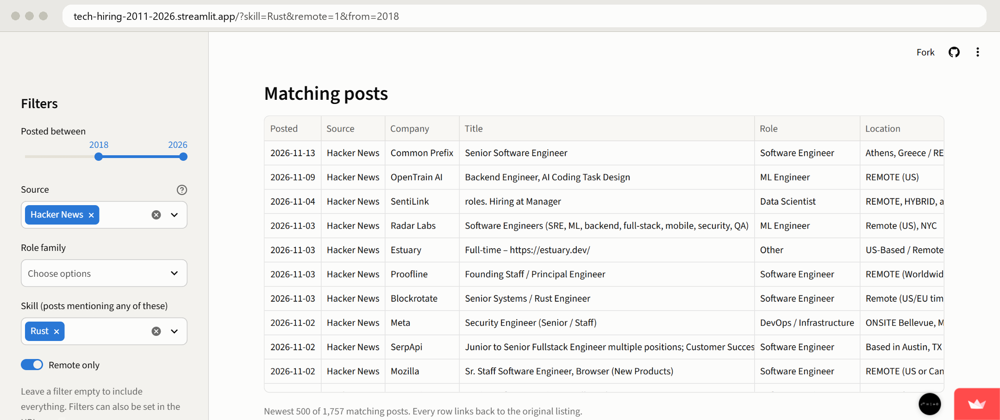

Endpoint: [`https://tech-hiring-2011-2026.streamlit.app/?skill=Rust&remote=1&from=2018`](https://tech-hiring-2011-2026.streamlit.app/?skill=Rust&remote=1&from=2018) (scrolled to the table)

The newest 500 matching posts, sortable and searchable, with company, title, role,
location, remote flag and salary. Each row links to the original listing, which keeps
the aggregates checkable and honours the boards' request for a link back.

### F. Comparing boards

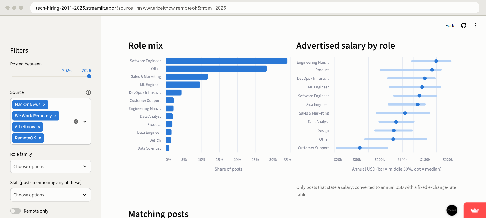

Endpoint: [`https://tech-hiring-2011-2026.streamlit.app/?source=hn,wwr,arbeitnow,remoteok&from=2026`](https://tech-hiring-2011-2026.streamlit.app/?source=hn,wwr,arbeitnow,remoteok&from=2026)

Selecting all four sources for 2026 gives the live version of figure 10: once the
general-purpose boards are added, sales, marketing, support and non-tech roles take up
a large part of the mix, and the salary panel gains roles such as customer support that
barely exist on Hacker News.

The screenshots are taken from the deployed app, not a local run, and each carries the
endpoint that produced it in its address bar. They are generated, not taken by hand:
`python -m reports.capture_dashboard` opens each endpoint in headless Edge and saves the
images, so they can be refreshed after every pipeline run.

## Reproduce

```powershell
python -m transform.run
```

```powershell
python -m reports.build_figures
```

Both read only local files. See the [README](../README.md) for collection commands,
the running plan and the data-ethics notes.
